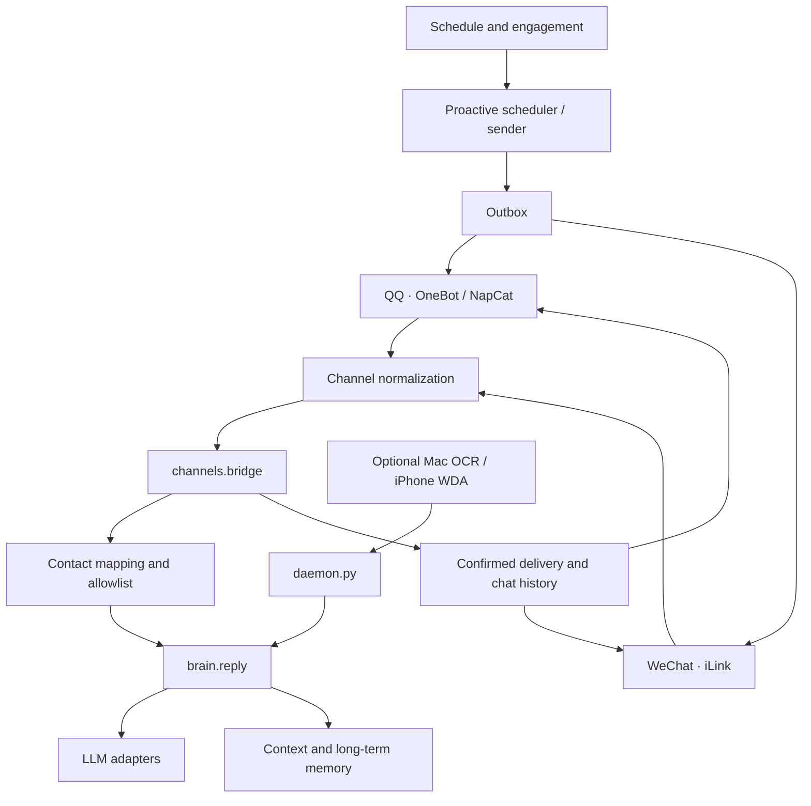

# Architecture

Xiaotian is a Python companion agent that connects QQ and WeChat channels to a shared conversation, memory, and scheduling core. This document describes the sanitized public snapshot; it does not describe any private deployment state.

## System overview

The primary channel path is `onebot_qq.py` / `ilink_weixin.py` → `channels.bridge.handle_inbound` → `brain.reply`. The optional UI daemon is a separate compatibility path, not a stage between the channel bridge and the brain.

## Main components

| Area | Entry points | Responsibility |
|---|---|---|
| Channel contracts | `src/channels/types.py`, `persona_map.py` | Normalize inbound/outbound messages and map channel peers to contact IDs. |
| Conversation bridge | `src/channels/bridge.py` | Serialize a turn, collect bursts, build context, gate media, and coordinate confirmed sends. |
| Reliable delivery | `send_receipts.py`, `outbox_store.py`, `outbox_send.py` | Track ACKs, preserve unknown outcomes, persist partial progress, and prevent blind retries. |
| Reply and model routing | `src/brain.py`, `src/llm.py`, `src/llm_adapters/` | Build the persona prompt, route short/long requests, and clean model output into chat bubbles. |
| Memory | `src/memory.py`, `src/mem.py`, `src/classmate_memory.py` | Maintain SQLite history, atomic contact state, and optional contact-scoped mem0/Qdrant retrieval. |
| Rhythm and proactive messages | `src/schedule.py`, `life_calendar.py`, `reply_engagement.py`, `proactive_*.py` | Apply daily rhythm, quiet windows, engagement, quotas, and proactive beats. |
| Media | `src/chat_media.py`, `src/imagegen.py`, `src/voice_asr.py` | Connect explicit image intents, image generation, inbound ASR, and outbound voice. |
| Optional UI compatibility | `src/mac_wechat_io.py`, `src/wechat_io.py`, `src/daemon.py` | Read and operate visible WeChat UI when a protocol channel is not used. |

## Delivery semantics

1. A channel event is normalized and checked against the configured contact allowlist before reply generation or media access.
2. A persisted inbound message has a stable fingerprint. Replayed events do not generate a second, different answer.
3. The answer is split into ordered bubbles. Each send has an operation ID; WebSocket transports additionally use a unique `echo` for the ACK.
4. HTTP/iLink results and OneBot receipts are validated before they count as delivered. A timeout or lost ACK becomes `DeliveryUnknown`, not an automatic resend.
5. Only confirmed bubbles are appended to chat history and delivery state. If a later bubble fails, earlier confirmed bubbles remain recorded and the remaining suffix can be recovered through the outbox.
6. Late ACKs are persisted once. Terminal bookkeeping is separated from transport success so a local bookkeeping error cannot trigger another send.

The relevant regression tests are in `tests/test_send_confirmations.py`, `tests/test_outbox_send_dedupe.py`, and `tests/test_channel_review_regressions.py`.

## Memory and state boundaries

- `data/chat.db` stores permanent message history. Channel peers that represent the same person map to one contact ID.
- `contacts/<id>/STATE.json` stores mutable contact state. Updates use a file lock, read-modify-write, and atomic `os.replace`.
- mem0 is used with `infer=False`; fact extraction and prompt construction remain in this repository. Qdrant runs locally and retrieval is scoped by contact ID.
- The public runtime is intentionally scoped to the fictional `demo_contact`. Classmate storage and filters are present as reference code, but the public bridge blocks non-primary contacts.
- Runtime databases, credentials, diaries, logs, and personal reference images are not part of the public snapshot.

## Time and proactive behavior

Wall-clock scheduling defaults to `Asia/Shanghai` through `src/timeutil.py`. Quiet-window checks for delivery and proactive scheduling are separate policies. Proactive messages pass through sleep, quota, freshness, and channel gates; drafts and failed sends do not count as confirmed contact.

## External resources

A private deployment can supply LLM credentials, channel credentials, persona files, and appearance references through local configuration. None are required by the offline unit tests or the Mock OneBot demo. Image references are inputs to the private image-generation path and are not redistributed here.

## Verification scope

The public test suite uses temporary directories, stub models, and simulated transports. It does not contact real QQ/WeChat accounts. `tools/onebot_mock_server.py` and `scripts/demo_onebot.sh` exercise the local QQ channel path without an external account; real-device and real-channel acceptance remain outside this public snapshot.
