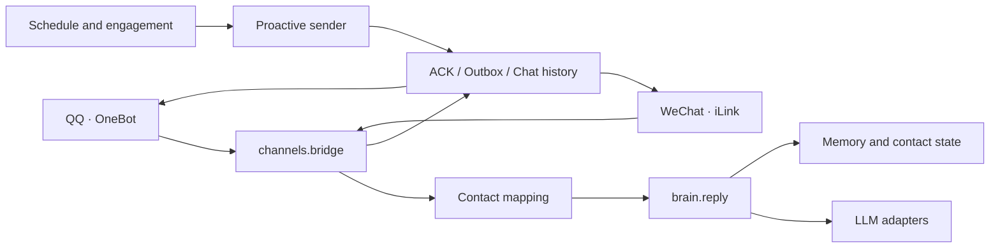

# Xiaotian — Proactive AI Companion Agent

[](https://github.com/xiaotian-wechat-team/xiaotian-QQ-gf-memeda/actions/workflows/tests.yml)
[](https://www.python.org/)
[](LICENSE)

> **English:** A proactive AI companion agent for QQ and WeChat, with contact-scoped memory, daily-rhythm scheduling, multimodal messages, and acknowledgement-aware delivery.

「小甜」是一个虚构的 AI 陪伴角色。本仓库展示其背后的 Python Agent：接入 **QQ OneBot / 微信 iLink**，按作息与聊天节奏主动触达，支持长期记忆、天气、生图和语音。

**这是用于代码展示与离线验证的脱敏公开快照，不是即插即用的聊天机器人产品。** 公开历史不包含私有仓库记录；真实联系人、凭据、聊天记录、日志和私人形象素材均未纳入。

## Engineering highlights

- **多通道统一编排**：OneBot 与 iLink 事件归一化为同一组 `Inbound` / `Outbound` 契约；桥接层处理连发消息合并、短气泡拆分、图文与语音出站。
- **主动行为与长期记忆**：作息、安静窗、回复节奏和主动配额共同驱动触达；SQLite 保存聊天历史，联系人状态原子更新，mem0/Qdrant 提供按联系人隔离的向量检索。
- **可靠发送而非盲目重试**：为发送操作分配稳定 ID，校验 ACK 与 `message_id`，区分 `failed` / `unknown`；迟到回执幂等入账，部分气泡成功后只恢复未发送后缀。
- **可离线验证**：临时数据库、模拟传输和本地 Mock OneBot 覆盖重复入站、超时、拒绝、迟到 ACK、部分发送等异常路径，不需要真实账号或 LLM 密钥。

## Local demo — no real account

环境要求：Python **3.11+**。完整依赖包含本地记忆、语音及 macOS UI 组件；非 macOS 会通过环境标记跳过对应平台依赖。

```bash
git clone https://github.com/xiaotian-wechat-team/xiaotian-QQ-gf-memeda.git
cd xiaotian-QQ-gf-memeda
python3 -m venv .venv
.venv/bin/python -m pip install -r requirements.txt -r requirements-dev.txt
cp config.example.json config.json
./scripts/demo_onebot.sh
```

Demo 只启动回环地址上的 Mock OneBot，依次执行 WS 探测、伪造私聊入站、burst 收集和固定 stub 回复，结束后自动清理进程。**不会连接真实 QQ/微信，不调用 LLM，也不写共享聊天记忆。**

## Architecture



完整的模块边界、发送语义和验证范围见 [ARCHITECTURE.md](ARCHITECTURE.md)。

## Code reading guide

| Topic | Start here |
|---|---|
| Channel normalization and contact routing | [`src/channels/types.py`](src/channels/types.py), [`persona_map.py`](src/channels/persona_map.py) |
| Turn orchestration and burst/media handling | [`src/channels/bridge.py`](src/channels/bridge.py) |
| ACK, idempotency, and partial delivery | [`send_receipts.py`](src/channels/send_receipts.py), [`outbox_store.py`](src/channels/outbox_store.py) |
| Prompt construction and model routing | [`src/brain.py`](src/brain.py), [`src/llm.py`](src/llm.py) |
| Persistent history and long-term memory | [`src/memory.py`](src/memory.py), [`src/mem.py`](src/mem.py) |
| Daily rhythm and proactive behavior | [`src/schedule.py`](src/schedule.py), [`src/proactive_scheduler.py`](src/proactive_scheduler.py) |
| Delivery regression scenarios | [`tests/test_send_confirmations.py`](tests/test_send_confirmations.py) |

## Tests

```bash
.venv/bin/python -m pytest -q
.venv/bin/python tools/onebot_qq_run.py --self-test
./scripts/demo_onebot.sh
```

GitHub Actions 在干净 macOS / Python 3.13 环境中执行以上检查。测试数量以当次 CI 输出为准；这里不把依赖私有资源的本地运行结果写成公开仓库指标。

## My role

我是项目的所有者与主要开发者，负责整体架构和主要实现，重点工作包括：

- 设计 QQ / 微信通道适配与共享联系人模型，将消息接入统一回复链路。
- 实现发送回执、Outbox、重复入站与部分发送处理，明确“未知结果不等于可以重发”。
- 实现作息调度、主动消息节拍、联系人状态与长期记忆检索。
- 建立本地 Mock 通道、离线回归测试和公开快照的脱敏/验证流程。

## Configuration and limitations

- 从 [`config.example.json`](config.example.json) 复制本地配置；密钥示例位于 `config/*.env.example`，真实 `config.json`、凭据和运行时数据均已加入 `.gitignore`。
- 公开快照仍保留 `demo_contact` 等演示标识，部分运行路径也固定使用该联系人。它用于展示原始架构，**不是通用的多联系人 SaaS 或纯配置化模板**。
- 私人形象参考图、数字生命目录和生产通道凭据属于仓外资源。没有这些资源时，离线测试与 Mock Demo 仍可运行，真实生图和真实通道不可用。
- 单元测试与 Mock Demo 不替代真实 QQ/微信账号验收；可选 Mac OCR / iPhone WDA 路径还需要相应设备与系统权限。

## License

[MIT](LICENSE)
