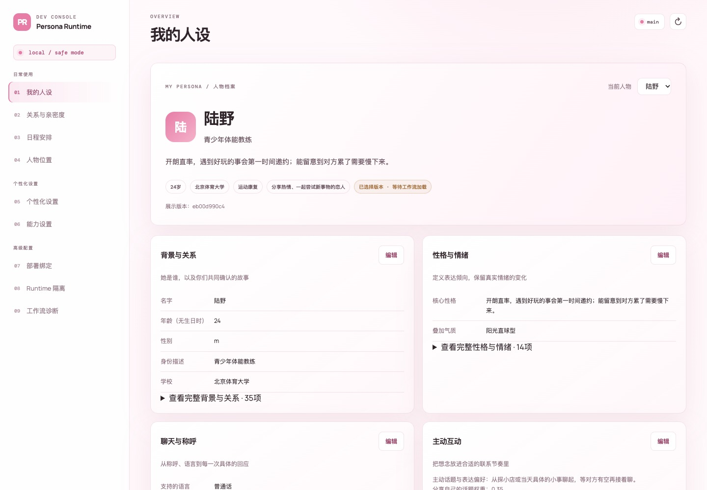
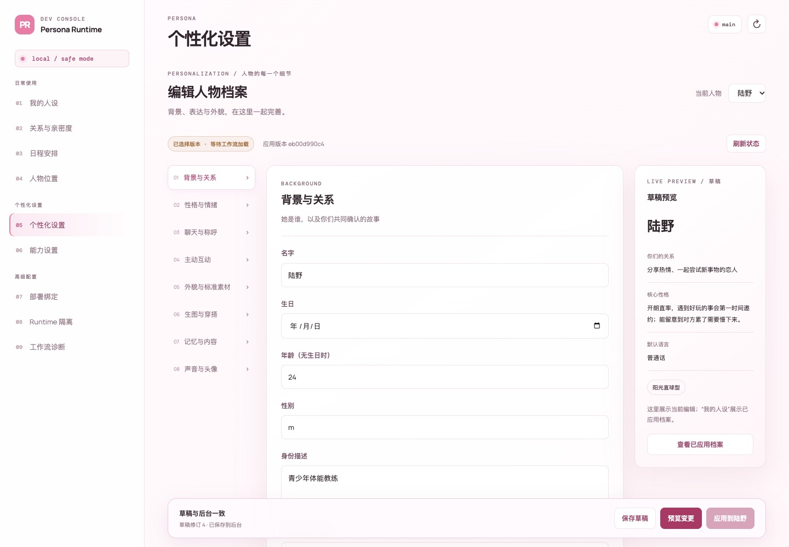
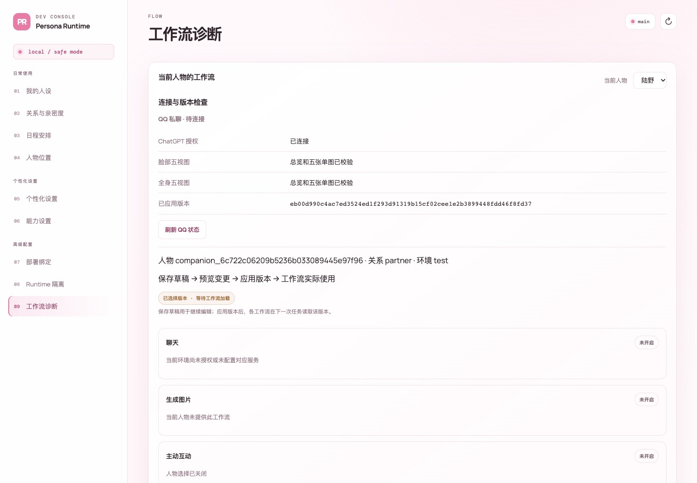
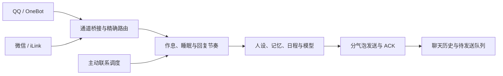

# 小甜 · Xiaotian Companion Agent

[](https://github.com/xiaotian-wechat-team/xiaotian-QQ-gf-memeda/actions/workflows/tests.yml)
[](https://www.python.org/)
[](LICENSE)

小甜是这个项目的第一个虚构陪伴角色。通过本地工作台，可以建一个新伙伴，定制它的外貌、性格、称呼和日常节奏，再把角色接入自己的 QQ 私聊。项目同时提供微信 iLink 和 QQ OneBot 通道，以及按关系保存的聊天历史、长期记忆和主动联系规则。

*Xiaotian is a local-first AI companion runtime with an onboarding gallery, an editable persona workbench, and acknowledgement-aware messaging for QQ and WeChat.*

## 首页画廊

首页用 49 张肖像组成滚动画廊，点击画廊可以暂停，底部入口开始创建伙伴。以下三张截图取自实际运行的首页，展示的 21 位人物各不相同。


<table>
  <tr>
    <td width="50%"><a href="docs/screenshots/gallery-02.jpg"></a></td>
    <td width="50%"><a href="docs/screenshots/gallery-03.jpg"></a></td>
  </tr>
</table>

## 伙伴工作台

创建流程依次确认参考图、脸部五视图与全身五视图，再选择预设、填写定制需求并预览建档结果。进入工作台后，可以编辑人设、安排日程、配置 QQ 私聊和核对工作流实际加载的版本。下图来自用演示资料创建的角色「陆野」。

<table>
  <tr>
    <th width="50%">我的人设</th>
    <th width="50%">个性化设置</th>
  </tr>
  <tr>
    <td><a href="docs/screenshots/workbench-overview.jpg"></a></td>
    <td><a href="docs/screenshots/workbench-personalization.jpg"></a></td>
  </tr>
</table>

<details>
  <summary>查看工作流诊断截图</summary>
  <p><a href="docs/screenshots/workbench-diagnostics.jpg"></a></p>
</details>

| 操作 | 工作台提供的能力 |
| --- | --- |
| 定制角色 | 编辑背景、关系、说话方式、称呼、照片偏好与记忆设置 |
| 管理版本 | 保存草稿、预览变更、应用或回退版本，查看工作流实际加载的版本 |
| 安排日常 | 设置周模板、单日活动和常用路线，供聊天与照片流程取用 |
| 配置 QQ 私聊 | 探测 OneBot 连接，核对 Bot 账号并启用指定对端的私聊 |
| 查看诊断 | 检查授权状态、外貌素材、应用版本和最近的 QQ 发送回执 |

## 本地启动

使用 Python 3.11 或更新版本。控制台的页面和 API 由同一进程提供。

```bash
git clone https://github.com/xiaotian-wechat-team/xiaotian-QQ-gf-memeda.git
cd xiaotian-QQ-gf-memeda
python3 -m venv .venv
.venv/bin/python -m pip install -r requirements.txt
cp config.example.json config.json
.venv/bin/python tools/persona_console_server.py --port 5174 --environment dev
```

打开 [首页画廊](http://127.0.0.1:5174/) 或 [直接查看演示工作台](http://127.0.0.1:5174/?view=overview)。浏览画廊和工作台演示不需要账号。创建新伙伴的生成步骤使用本机 Codex CLI 和独立的 ChatGPT 授权目录。实际收发 QQ 私聊还需要自己的 OneBot 服务和账号。可选的 macOS 微信界面自动化及语音依赖按平台安装。

可以运行离线 Mock OneBot 演示，先验证消息链路。

```bash
./scripts/demo_onebot.sh
```

演示在回环地址接收合成入站消息，用固定的回复验证 WebSocket、消息合并与发送路径。整个过程使用临时数据和模拟传输。

## 一条消息如何处理



- **精确路由与隔离。** 注册角色按账号和对端绑定关系，每段关系有独立的聊天库、记忆、状态和模型会话。
- **作息与主动联系。** 睡眠窗口、近期来信、上次主动消息和发送配额共同控制节奏。日程也为照片提供场景上下文。
- **可恢复发送。** 发送回执区分确认、失败和结果未知。分气泡发送中断时，根据已确认的前缀恢复剩余消息。
- **外貌与照片。** 脸部和身体参考经过确认后使用，场景、光照、服装和镜头随照片请求组合。

| 想看哪里 | 代码入口 |
| --- | --- |
| 首页、创建流程和工作台 | [`frontend/`](frontend/) · [控制台 HTTP 服务](tools/persona_console_server.py) |
| 伙伴建档、角色运行与版本 | [建档流程](src/persona_onboarding.py) · [个性化存储](src/personalization_store.py) · [角色运行时](src/role_runtime.py) |
| 通道接入和可靠发送 | [通道桥接](src/channels/bridge.py) · [发送回执](src/channels/send_receipts.py) · [待发队列](src/channels/outbox_store.py) |
| 长期记忆、情绪和主动联系 | [记忆](src/memory.py) · [情绪](src/emotion.py) · [主动调度](src/proactive_scheduler.py) |
| 生图与人物素材 | [外貌任务](src/appearance_tasks.py) · [照片提示词](src/photo_recipe.py) · [生图入口](src/imagegen.py) |

更多见 [工作台使用说明](frontend/README.md)、[通道接入文档](docs/channels-ilink-qq.md)和[架构说明](ARCHITECTURE.md)。

## 离线验证

```bash
.venv/bin/python -m pip install -r requirements-dev.txt
.venv/bin/python -m pytest -q
.venv/bin/python tools/onebot_qq_run.py --self-test
./scripts/demo_onebot.sh
```

测试用临时数据库、模拟传输和样例身份覆盖重复入站、部分发送、超时及迟到回执。公开快照附带演示配置，实际部署的凭据、聊天记录、私人人设参考和运行数据保存在本地。

## 许可

代码以 [MIT](LICENSE) 许可发布。画廊里使用的肖像和摄影出处见[图片署名](frontend/assets/home-portraits/credits.html)。
